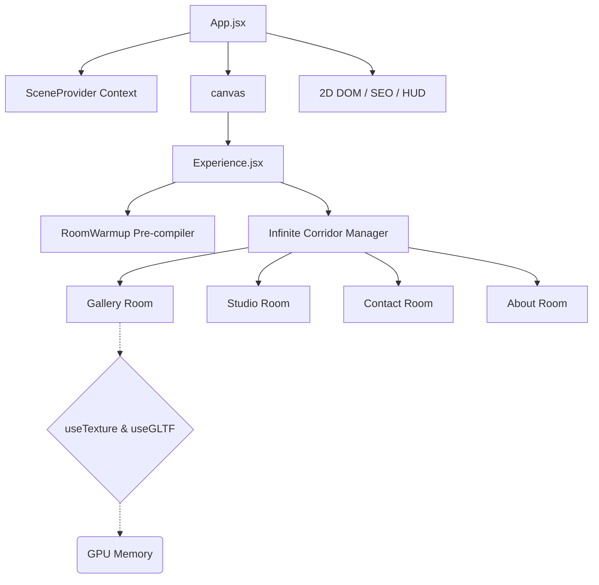

# 🎨 POLARIS | Interactive 3D WebGL Portfolio

<div align="center">
  
  
  
  
  
</div>

<br/>

POLARIS 是一个沉浸式 3D Web 个人作品集网站，融合空间 WebGL 渲染、复杂 React 生态与高度优化的前端工程，将个人项目、学习历程与经历以「无限走廊 + 主题房间」的形式呈现。

> [!NOTE]
> 建议在浏览器中开启硬件加速，以获得流畅的高帧率渲染体验。

## 🚀 核心性能架构

应用针对跨设备运行做了严格优化，通过多项定制化架构实现在移动端处理器上也能保持零卡顿：

1. **不可见语义 SEO 降级**：通过 `sr-only-seo` 索引 DOM 注入，绕过 WebGL canvas 的 SEO 局限，向搜索引擎爬虫渲染完整语义树，无需挂载重 bundle。
2. **异步着色器编译**：在 Preloading 阶段于隐藏的 `RoomWarmup` Suspense 边界内执行 `gl.compileAsync`，让 Three.js 异步预编译复杂材质，不阻塞主 React 更新线程。
3. **烘焙全局色调与光照提取**：用烘焙的全局纹理替换实时 WebGL 阴影贴图与无限光线，大幅降低 GPU 计算开销，同时保留视觉深度。
4. **绕过 DOM 变更**：关键动画属性（如追踪 130+ 并发 HTTP 纹理请求的 SVG 预加载状态）直接写入 `ref.current.style`，绕过 React 的 `setState` 渲染循环以节省 CPU。
5. **自适应设备分级**：自动检测 `navigator.deviceMemory`、硬件并发数与视口大小，动态调整 WebGL 分辨率（`dpr`）、抗锯齿算法与纹理加载严格度。

---

## 🏗️ 3D 场景架构



---

## 🛠️ 本地开发

在本地运行此应用：

1. **克隆仓库：**
   ```bash
   git clone https://github.com/huahua1229/Polaris.git
   cd Polaris
   ```

2. **安装依赖：**
   确保使用 Node.js v20+。
   ```bash
   npm install
   ```

3. **启动开发服务器：**
   ```bash
   npm run dev
   ```

4. **一键启动（本地预览已构建产物）：**
   双击项目根目录的 `启动3D站.bat`，会自动启动并打开 http://localhost:4173/

> [!IMPORTANT]
> 项目使用 `vite-plugin-compression` 与数百张高分辨率纹理，本地首次加载可能需要几秒。性能测试请运行 `npm run build && npm run preview`。

---

## 🎨 视觉风格

- **手绘素描风**：整体呈现铅笔手绘质感
- **主题房间**：Gallery（画廊）、Studio（工作室）、About（关于，天空云层）、Contact（联系，海港漂流瓶）
- **中文字体**：得意黑 Smiley Sans + 子集化楷体（`public/fonts/`）
